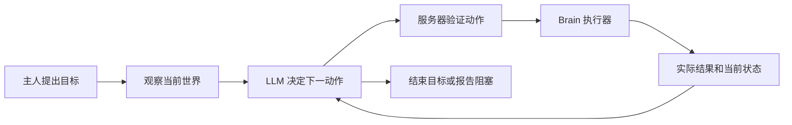

# 动作接口与自主任务架构

设计日期：2026-10-20。本页先于实现建立，以下为完成实现后的架构与接口记录；适用于 Core / Farming / Lumber 1.3.0、LLM 0.3.0。

## 分层与职责

| 层 | 职责 |
| --- | --- |
| Core 动作目录 | 注册带类型参数的有限动作；校验数量、物品、目标类型、范围；不依赖 LLM 或具体工作插件 |
| 环境观察 | Core 观察位置和箱子，工作插件提供农田与树木；仅返回已加载范围内的真实目标 |
| Core 执行器 | Brain 每 tick 驱动一个动作；寻路、交互、超时、暂停、取消均在服务器线程处理 |
| Core 目标任务 | 保存主人原始目标、授权时的位置、当前动作、不可变执行记录、预算及终态 |
| LLM 决策循环 | 异步调用模型，等待游戏动作完成，将实际结果和新状态送回模型，再决定下一步 |
| 玩家界面 | 显示观察/思考/执行/暂停/完成/失败进度；取消同时终止执行与后续决策 |

## 动作契约

统一动作结果包含状态、原因及实际进度。动作构造和参数校验不修改世界。只有服务器 tick 可以提交物品或方块变化；暂停清理导航、开箱、破坏进度，保留已提交效果。

- `move_to(target)`：实际步行到观察目标附近；不传送。
- `equip_tool(slot, item)`：核对背包格和期望物品后装备主手，旧装备回到背包。
- `chop_tree(target)`：只处理观察过的树，复用自然树判断、工作站位和渐进破坏；分别记录砍断、跳过、实际拾取的数量。
- `harvest_crops(target, item, count)`：在观察区域内补足指定作物库存，收获补种，仅计实际进入背包的净数量。
- `deposit_items(target, item, count)`：从真实背包向目标箱子转移精确数量，部分存入不回滚。
- `return_to_owner()`：步行到主人当前所在位置。

保留已发布的小麦动作和固定计划作为兼容入口，共用动作实现。可选插件未安装时，其动作和观察能力不进入目录。

## 目标与异步协议

状态为「等待模型 → 执行动作 → 等待模型」，工作遇袭可暂停；终态为成功、失败、取消。每次最多执行一个动作。动作工具的最终结果延迟到游戏动作结束才写回模型上下文，不用“已受理”代替完成。

主人第一次聊天通过近距离授权；自动后续决策绑定同一个主人、实体实例、目标实例和命令版本。后续执行不再要求主人始终处于聊天距离，但目标限定在起点周围的有界范围内，不主动加载区块。

执行记录不可变，模型能看到失败前已经转移的数量。调整计划需要基于剩余数量；不得再次执行已完成部分。动作请求标识去重。失败次数、动作次数、无动作的模型轮数和总时长均有限制，避免无限重复和无界费用。

手动切换模式、取消、死亡、卸载、换主人、主人离线/跨维度、服务重载会终止目标。每个 HTTP 回调重新检查任务身份；终止后迟到的响应不能恢复执行。服务器重启后不重放任务。

模型负责解释自然语言目标及判断是否还需下一步；服务器负责核实每个动作实际做了什么。模型的目标完成判断与服务器确认的动作结果在数据中分别记录，不能把文本声明当作物品转移证据。

## 验证计划

1. 真实服务器 GameTest：每个动作、类型/权限/距离校验、资源不足、满箱、部分完成、暂停恢复、手动接管、卸载与预算。
2. 本地模拟模型加真实客户端：观察、等待动作、根据失败结果改用主人允许的备用目标、精确剩余数量、完成进度和取消。
3. HTTP 故障与迟到回复：取消/重载/换模式后不再执行；无动作循环与重复动作受到预算限制。
4. 可选插件隔离和原有 Core/Farming/Lumber/LLM 回归；检查发布包不含测试代码。
5. 最终以源码和测试结果更新 README、LLM、Addon API、验收及相关工作文档，标记仍适用的历史版本说明。

## 实现与验证记录

实现分为三个可独立使用的部分：

| 类 | 所属模块与作用 |
| --- | --- |
| `MaidActions` / `MaidAction` | Core：动作元数据、统一参数预检、实例工厂、tick与结果契约 |
| `MaidObservations` | Core：加载区块内的有界快照与插件观察提供者 |
| `MaidTaskRunner` / `MaidPlanBehavior` | Core：固定计划与自主目标共用 Brain 执行入口 |
| `MaidPlanTask` | Core：顺序计划与单动作子执行器，冻结每步记录 |
| `MaidGoalTask` | Core：目标、主人、起点、预算、当前动作、终态、请求去重 |
| `HarvestCropsAction` | Farming：复用收获补种事务；旧 `CollectWheatAction` 变为兼容适配 |
| `ChopTreeAction` | Lumber：指定树队列、工具耐久、渐进破坏与实际拾取 |
| `ActionTools` | LLM：动态Schema、目标token、严格JSON与整数校验 |
| `GoalDecisionLoop` | LLM：异步决策、延迟工具回填、上下文与预算、迟到回复失效 |
| `LlmService` | LLM：玩家会话、开始/取消目标、进度推送与生命周期 |

### 一个完整例子

主人要求“收集3个小麦，放入A；A满了就用B，最后回来”：

1. `start_goal({})` 接受本轮原话，返回 `task_started=true, work_completed=false`。
2. 模型观察A、B和成熟作物区域，查询背包已有1个小麦。
3. `execute_action({request_id:"harvest-1", step:{action:"ai-maid-farming:harvest_crops", target_id:"…", item:"minecraft:wheat", count:3}})`；Java收获补种2个，直到背包真的达到3个才把结果发给模型。
4. 向A存放3个，A只容纳1个：结果是失败，`delivered=1, remaining=2`。目标仍可继续，因为尚未耗尽失败预算。
5. 模型读取记录，向已授权的B存放2个；之后调用返回动作，等待真实到达，再 `finish_goal(completed, summary)`。

游戏状态、当前观察和已执行账本每轮重新提供。模型生成的 `request_id` 只用于去重，不是目标ID。重复已接受请求返回原结果，不再次执行；同ID不同参数拒绝。目标结束后不能继续提交。

### 实际边界

- 动作数量1..64；收集表示达到库存总量，作物一次收获可能超过目标，超出物品留在背包。存放则精确限制转移数量。
- 观察默认半径8、最大16；箱子上下4格、农田上下2格。Core最多24个箱子，插件观察合计最多48个目标。单只女仆最多64个token，1200游戏tick失效；重新观察未变化目标刷新有效期。
- 位置或目标在动作提交时须距女仆32格内。目标范围默认起点周围64格，配置16..128；不等于自动探索整个范围。实时世界校验、寻路与视线仍可拒绝动作。
- 单动作最多2400活动tick；目标默认12000活动tick，默认16动作、3次实际动作失败。战斗暂停不消耗这些游戏计时；HTTP仍有独立超时。
- 每次动作之间无新动作的决策默认4批；查询、非法动作、返回缓存结果均消耗预算。至少允许“一批观察，然后执行”。实际动作结束后重置该预算。整个目标的HTTP决策另限128次以内。
- 观察ID证明对象来自本次真实世界，不证明模型正确理解了自然语言指代；是否允许换箱仍需要模型遵守原始目标。服务器不允许生成任意代码或命令。
- 目标终态的 `completion_source=planner_with_server_action_receipts` 明示语义完成判断来自模型；动作记录分别包含数量、物品、位置、槽位、状态和原因。
- 工具装备目前只针对主手工具。收获仅四种常见作物。没有新增通用取箱、合成、放置、搭梯、挖路或动物喂养动作；现有持续工作模式仍可选择。

### 验证与修复

`GoalActionGameTests` 验证通用物品存放、非小麦收获与补种、真实移动、装备槽变化、指定树砍伐/拾取/耐久、错类型目标、树变化、满背包，以及目标的无动作等待、证据约束、幂等、预算、超时、手动取消、卸载和真实战斗恢复。

`GoalClientGameTest` 仅模拟模型响应，使用真实HTTP、游戏服务器、客户端聊天、Brain和库存。包含上述A/B箱部分失败恢复、恰好剩余数量、旧请求去重、主人离开聊天距离、取消/切换/重载后的迟到回复、无动作循环和HTTP错误。将无动作预算设为1仍能完成观察→动作→结果循环。

首轮测试发现掉落原木尚未落地时过早判定不可达，已增加有界落地等待并使用适合游戏交互的接近范围；重跑砍伐与实际拾取验证通过。最终运行命令、数量、日志与截图统一见 [验收记录](ACCEPTANCE.md)。真实提供商模型未在本次测试中调用。

