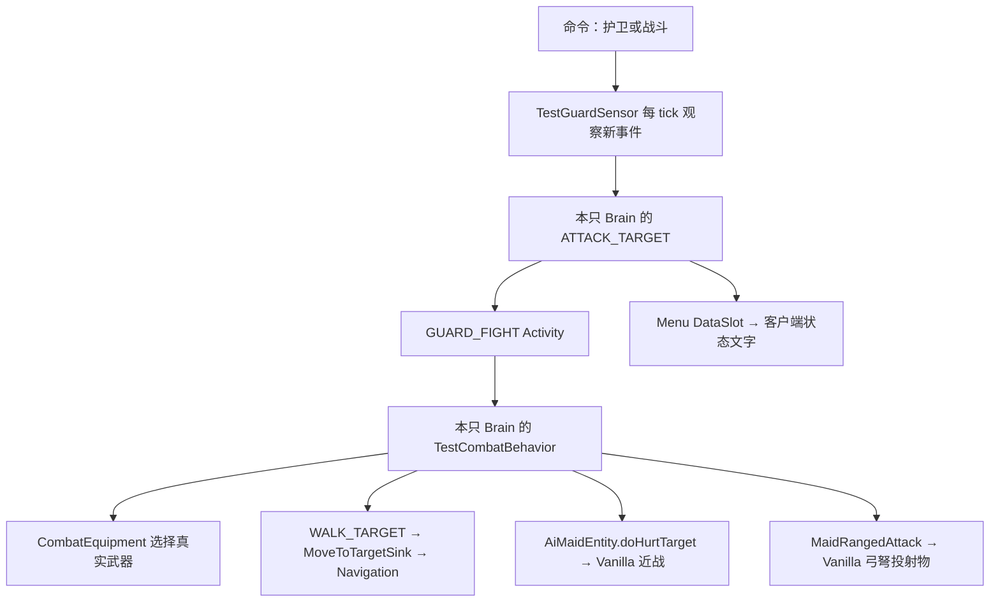

# 战斗系统（Minecraft 26.2）

本轮从 `5e35289` 的近战护卫版本继续开发。战斗策略仍在 TestAddon，Core 只新增实体攻击、真实弹药与投射物发射支持。需要同时加载 Core 和 TestAddon；根目录 `runClient` 只加载 Core，日常体验战斗可在 `addon/testaddon` 中运行 `gradlew runClient`，或使用 `dev/devrun`。

后续已接入[工作中自卫与战后恢复](WORK_DEFENSE.md)：伐木、巡逻复用同一个战斗 Activity，仅因自身遇袭中断，命令和任务保持不变。下文的验收数量是最初战斗里程碑的记录；最新增量验收见该文档。

GUI 可以选择“护卫”和“战斗”；命令也支持原有 nearest、selector、uuid、name 入口：

```text
/maid nearest command testaddon:guard
/maid nearest command testaddon:attack
/maid nearest gui
```

| 模式 | 会主动做什么 | 共同能力 |
| --- | --- | --- |
| 护卫 `testaddon:guard` | 跟随主人，收到新的伤害/攻击记录时参战 | 自卫、护主、协助主人攻击、近战、弓、弩、换武器、脱战 |
| 战斗 `testaddon:attack` | 在护卫基础上，主动寻找附近可见的敌对生物 | 同上 |

把剑、斧等带 `WEAPON` 组件的近战武器、弓或弩放进女仆 storage 或手部槽；箭可以放 storage 或副手。每次装填消耗真实箭，武器使用真实耐久。无限弓仍需至少一支普通箭；光灵箭、药箭和附魔效果交给原版处理。弩自动射击只接受箭，不发射烟花；副手烟花也会阻止该弩进入自动装填流程，请收回 storage。

远处优先使用有弹药的远程武器，靠近后优先近战。当前持近战武器时，超过 6 格才尝试切远程；当前持远程武器时，低于 3 格才尝试切近战，避免在一个边界来回切换。没有可用远程武器或箭时继续近战；没有近战武器时仍能空手或用现有手持物攻击。有多把近战武器时按主手攻击属性选择，不计算所有附魔与敌人组合的最优 DPS。

换装复用 `MaidItemTransfer`，交换的是原来的两个 ItemStack，因此满背包也能交换，名字、组件、附魔、耐久不会重建丢失。正在拉弓/装弩时不主动换武器；外部取走或更换武器会取消当前使用。装好的弩在停工时保留 `CHARGED_PROJECTILES`，其中的箭不会因为取消命令而消失。Core 1.1 已统一 GUI、工作和战斗的换装规则，六槽均尊重 `PREVENT_ARMOR_CHANGE`，创造模式主人可手动取下。详见 [Core 1.1](CORE_1_1.md)。

选敌优先级是新的自卫目标、伤害主人的目标、主人攻击的目标、主动扫描的敌人。同等优先级保持当前目标，较高优先级可以中断当前目标。不会攻击玩家、主人、同队友方或已驯服的宠物。主动扫描默认选 `Enemy` 且非 `NeutralMob` 的生物；中立生物可以通过自卫或协助触发。

| 参数 | 当前值 | 含义 |
| --- | --- | --- |
| 主动搜索 | 16 格 | 只选当前可见目标 |
| 追击边界 | 24 格 | 女仆和目标都不能离主人过远，彼此也不能超过此距离 |
| 远程射程 | 12 格 | 超出后通过导航接近 |
| 连续失去视线 | 100 tick | 超时放弃 |
| 无接近进展 | 160 tick | 可见但接近不了也会放弃 |
| 单次目标上限 | 1200 tick | 避免永远纠缠同一目标 |
| 失败目标冷却 | 200 tick | 放弃后暂时不重新追逐该目标 |

以上 tick 按正常 20 TPS 运行。主人不可用时不主动清怪，也不继续原来的护主追击；新的自卫以女仆开战位置作为边界。目标死亡、跨维度、离开范围、路径失败、切换命令都会结束追击。脱战后按距离选择归队、拾取或待机。切到 STAY/FOLLOW/FREE/PATROL/LUMBER 会停止战斗；当前支持巡逻和伐木因自身遇袭而临时自卫，战后恢复原工作；其他工作命令需要各自明确接入。

箭发射前检查友方是否挡在射线上；发射后又进入弹道的友方由服务器伤害事件保护。这是 TestAddon 的 PvE 政策，无法据此宣称兼容任意模组的自定义伤害实现。这里没有 PvP、盾牌格挡、投掷三叉戟或 Boss 专用战术。

数据包可用两个实体类型标签扩展目标规则：

```text
data/testaddon/tags/entity_type/combat_targets.json
data/testaddon/tags/entity_type/combat_ignored.json
```

`combat_targets` 增加主动清怪的实体类型，`combat_ignored` 排除所有选敌入口中的实体类型。示例文件结构为 `{"replace": false, "values": ["othermod:hostile"]}`。排除标签和友方保护优先于主动目标标签，不允许用标签打开 PvP。

运行链可以按下面的顺序阅读：



`TestGuardCommand` 与 `TestAttackCommand` 是 Registry 中共享的策略对象，只决定模式。两者共用一个 `GUARD_FIGHT`，只有护卫贡献该 Activity，战斗命令不重复注册。新增命令由已有菜单自动枚举，GUI 没有写死战斗按钮。

每只女仆创建 Brain 时，SensorType 创建自己的 `TestGuardSensor`，`createActivities(maid)` 创建自己的 `TestCombatBehavior`。Sensor 保存受伤时间戳、追击进展和失败目标冷却，Behavior 保存本次蓄力武器和目标；这些运行状态没有放在 Command singleton 中，也不持久化为永久仇恨。Sensor 在切换模式和主人时更新事件基线，所以切回护卫不会重放以前的一次受伤。

Sensor 决定“打谁”，写入 `ATTACK_TARGET`。现在进入/退出战斗时，Sensor 会先停止旧行为并按当前命令切换 Activity，让工作中断发生在行为执行前；`AiMaidAi.updateActivity` 仍在 Brain.tick 之后做常规候选更新。Behavior 再决定靠近、近战、拉弓、装弩或射击。移动只写 `WALK_TARGET`，实际导航仍由 Core 的 `MoveToTargetSink` 执行。

近战调用 `AiMaidEntity.doHurtTarget`，父类 Mob 负责攻击属性、附魔、击退和伤害。26.2 的 Mob 缺少玩家攻击链末尾的 `postHurtEnemy` 耐久步骤，所以实体补上它。攻击冷却放在本只 Brain 的 `ATTACK_COOLING_DOWN`，由攻击速度决定且至少间隔 10 tick；重新点命令不能绕过冷却。

弓不是直接调用玩家专用的 `releaseUsing`。`MaidRangedAttack` 通过一个很小的 Mixin Invoker 调用 `ProjectileWeaponItem.draw/shoot`，保留原版弹药拆分、无限、多重射击、投射物创建、附魔和耐久逻辑。弓拉满 20 tick 再射击。弩由 `LivingEntity` 正常驱动 `CrossbowItem.onUseTick` 完成装填，再通过 `performShooting` 发射；快速装填附魔仍能影响原版装填时间。两种远程武器射击后有 20 tick 冷却。

`AiMaidEntity.getProjectile` 返回手部或 storage 中真正的弹药栈；不是 `copy()`，也不会凭空生成箭。原版装填对这个栈进行拆分，剩余数量留在原处。`getTarget()` 将 Brain 目标提供给原版生物接口；Core 单独运行、没有注册战斗 Memory 时也能安全查询。

客户端只读取实体已有的手持与使用状态来生成拉弓、装弩、持弩姿势。装备包和使用状态包独立同步，因此停止使用、换装和再次使用要留出 tick 边界。GUI 的装备镜像没有写回世界实体；Activity 依然来自服务端 Menu DataSlot。

本轮已经实际执行以下验收：

| 验收入口 | 结果 |
| --- | --- |
| 根目录 `gradlew build` | Core 独立构建通过 |
| `addon/testaddon` 中 `gradlew build` | Addon 构建通过；24 项服务器 GameTest 全部通过，其中 23 项战斗用例和 1 项框架测试 |
| `dev/devrun` 中 `gradlew build` | Core + TestAddon Composite Build 集成构建通过 |
| `addon/testaddon` 中 `gradlew runClientGameTest` | 真实客户端与集成服务器验收通过 |

服务器测试覆盖：无故不开战、自卫、护主、协助、主动清怪、真实近战与箭伤、弓弩弹药/耐久、无限、光灵箭、多重射击、弹药用尽转近战、损坏武器替换、满包交换保留组件、取消拉弓、保留装填箭、遮挡/不可达/超范围/主人离开/目标死亡后的脱战、旧受伤记录不重播、多只女仆状态独立以及友方保护。

客户端测试使用真实 ServerPlayer，检查三种远程姿势、77 槽菜单、翻页按钮、点击“战斗”后服务器命令和客户端镜像一致；随后在生存模式实际触发护主和协助攻击，验证玩家免受女仆箭伤，验证 GUI 显示服务端 `GUARD_FIGHT`。截图经过查看。测试文件位于 `addon/testaddon/src/gametest`，不打进发布 JAR；常规 `build` 运行服务器测试，客户端测试需显式运行。CI 已加入 Addon 服务器测试和 devrun 构建，客户端图形测试在本机运行。

本轮本机日志和截图保存在忽略目录 `build/combat-acceptance/`。自动测试使用临时世界，没有使用日常开发存档。测试通过不等于已经做过多人长时间联机、重连/跨服或任意第三方保护模组兼容验收；本轮也没有增加死亡背包处置或全面的护甲政策重构。

主要阅读入口：

- [选敌、追击和失败冷却](../addon/testaddon/src/main/java/io/github/ozozorz/testaddon/ai/TestGuardSensor.java)
- [近战与远程执行](../addon/testaddon/src/main/java/io/github/ozozorz/testaddon/ai/behavior/TestCombatBehavior.java)
- [武器选择](../addon/testaddon/src/main/java/io/github/ozozorz/testaddon/combat/CombatEquipment.java)
- [目标与友方规则](../addon/testaddon/src/main/java/io/github/ozozorz/testaddon/combat/CombatRules.java)
- [Core 远程机制](../src/main/java/io/github/ozozorz/aimaid/entity/ai/behavior/MaidRangedAttack.java)
- [服务器测试](../addon/testaddon/src/gametest/java/io/github/ozozorz/testaddon/CombatGameTests.java)
- [客户端测试](../addon/testaddon/src/gametest/java/io/github/ozozorz/testaddon/CombatClientGameTest.java)
