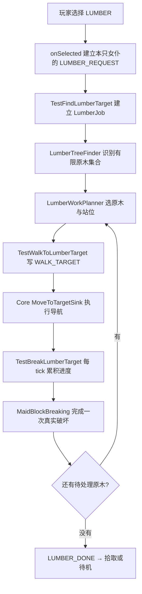

# 死亡携带物与持续伐木（Minecraft 26.2）

本轮基于已验收的战斗版本 `4c8810c`。Core 管理死亡携带物、持续行为的生命周期和方块破坏机制；TestAddon 管理树的选择、站位、队列、工具要求与本轮作业规则。没有增加通用职业系统，也没有把伐木状态塞进共享的 Command。

后续已加入[工作中自卫与战后恢复](WORK_DEFENSE.md)：临时战斗保留整树队列，当前未完成的一块重新积累进度，手动换命令仍取消任务。最新增量验收见该文档。

## 使用与本轮边界

同时加载 Core 和 TestAddon，在女仆主手或 storage 放入斧头。GUI 的“伐木”按钮现在会识别附近一棵树，逐块处理其中能够实际触及的原木。也可以使用：

```text
/maid nearest command testaddon:lumber
/maid nearest command testaddon:lumber single
```

第一条对应 GUI 的整树模式；第二条明确只处理附近一块原木，不要求自然树形。两者沿用所有权授权和原有 nearest、selector、uuid、name 入口。再次选择会开始新一轮，切换到其他命令会立即停止旧动作。命令反馈中原有的翻译键拼写错误也已修复。

**按本次确认的设计，女仆必须亲自走到伸手可及的位置；够不到的高处原木会保留。** 不在树根隔空连锁破坏，不搭梯子、不放置脚手架、不专门挖路。一次整树请求处理一棵已识别树的有限队列，结束后拾取或待机，不自动扩展成无限清空森林。主人会收到砍伐数、跳过数和结束原因。

没有斧头时结束本轮；已有斧头损坏后，会从 storage 换备用斧继续。普通拾取沿用既有系统，满背包时掉落物可以留在地上。世界关闭 `mobGriefing` 时不开始或继续破坏。砍伐只移除原木，树叶交给原版衰败；没有补种、资源搬运或自动恢复存档中的旧任务。

## 死亡携带物

死亡时，35 个 storage 槽与六个支持的装备槽中的物品转为实际掉落。名字、附魔、耐久、弩内已装填的箭等 components 保留。实现先把源槽位置空，再生成掉落，避免两个位置同时持有同一份物品。

| 情况 | 结果 |
| --- | --- |
| 环境或怪物杀死女仆 | 携带物照常掉落，无需玩家击杀归属 |
| 消失诅咒 / `PREVENT_EQUIPMENT_DROP` | 对 storage 和装备都生效，物品清除而不掉落 |
| 绑定诅咒 | 不阻止死亡掉落 |
| 玩家 `keepInventory` | 只控制玩家，不替女仆保留物品 |
| `mobDrops=false` | 不删除女仆已经携带的物品 |
| 卸载、存档或跨维度移除 | 停止持续动作，不触发死亡掉落 |
| 死亡时背包仍打开 | 原有 `stillValid` 关闭容器，原版 Menu 处理光标携带物 |

原版 `Mob.dropCustomDeathLoot` 会按概率掉装备，并可能改变耐久。因此女仆覆盖该步骤，统一在 `dropEquipment` 转移自己的携带物。这个选择不新增第二套装备数据，装备仍以 `EntityEquipment` 为准；BODY/SADDLE 不在项目当前六槽契约内。

`die` 与 `onRemoval` 先调用 `Brain.stopAll`，使正在执行的行为有机会清掉裂纹、蓄力和导航。死亡掉落只走死亡链；不能把清理行为与掉落物品放进同一个通用“移除实体”回调。

## 从一次请求到每块原木



Registry 中的 `TestLumberCommand` 是共享的定义。每只女仆创建 Brain 时，通过 `createActivities(maid)` 创建自己的持续破坏 Behavior；一次工作启动时再创建自己的 `LumberJob`。因此队列、计数、破坏进度和工具引用不会在两名女仆之间共享。

| 数据 | 含义与保存位置 |
| --- | --- |
| `LUMBER_REQUEST` | 一次请求；false 是整树，true 是单块，无值表示没有新请求 |
| `LUMBER_JOB` | 本次原木及其预期 BlockState、完成/跳过数、时间限制 |
| `LUMBER_TARGET` | 当前要破坏的原木 |
| `LUMBER_WORK_POS` | 当前计划脚部站位 |
| `WALK_TARGET` | 给原版导航执行器的移动意图 |
| Behavior 字段 | 当前方块、工具引用及快照、进度、已发送的裂纹阶段 |
| `LUMBER_DONE` | 本轮尝试结束，不等于所有原木成功砍掉 |

以上工作 Memory 没有 Codec。重载会保留实体的 LUMBER 命令，但不会恢复旧队列、旧进度或自动发起新一轮，需重新选择。`LUMBER_DONE` 保留到重新选择，防止刚结束就立即重启。

站位分两条路径：现在已经站稳、可见且够得着，就直接作业；否则生成有限候选站位，检查支撑、液体、实体碰撞和假想眼睛到原木的视线，再用 `createPath(Set<BlockPos>, 0)` 寻路。路径必须 `canReach()`。实际移动仍由 `MoveToTargetSink` 执行。

到位后再次用真实眼睛坐标校验距离与视线。途中目标改变、站位失效、长时间无法到达时跳过当前块。刚生成或下落时暂不规划，因为原版地面导航在此时可能返回 null，不能据此宣布原木不可达。这一处由真实 tick 测试发现并修复。

## 进度、裂纹与最终破坏

`MaidBlockBreaking` 是无状态机制，不认识树或伐木命令。它读取实际工具的破坏速度，以及女仆的挖掘属性、效率附魔所提供的属性、急迫、挖掘疲劳、水下与离地因素。核心公式沿用 26.2 的计算方式：

```text
每 tick 进度 = 有效工具速度 / 方块硬度 / (工具满足掉落要求 ? 30 : 100)
```

硬度为负时不能破坏，硬度为零时可立即完成。伐木 Behavior 要求站稳，按 tick 累积进度，每六 tick 挥手，进度映射为原版 0..9 裂纹阶段。裂纹通过 `ServerLevel.destroyBlockProgress` 同步，不建立新的客户端进度协议。

进度未完成时不产生掉落、不扣耐久。进度达到 1 后再检查存活、原木仍为预期状态、加载状态、世界边界、实际触及范围、视线、`mobGriefing` 与工具 `canDestroyBlock`。然后执行一次世界破坏、真实工具的 `mineBlock` 耐久步骤，以及带工具快照的 `Block.dropResources`。工具快照保留破坏前的附魔等组件，避免最后一点耐久耗尽后用空工具计算掉落。

换了工具或修改了工具组件，当前进度从零开始；停工、换目标、死亡和卸载发送阶段 -1 清裂纹。两个工作者看上同一块原木时，后完成者会重新看到世界已改变，不再生成第二份掉落或扣第二次耐久。

这里没有创建 Fake Player，也没有宣称复刻玩家专用的破坏事件、统计、领地授权或所有模组工具行为。Core 只提供生物可用的机制；本轮对真实原版工具和方块进行了验证。

## 树的识别范围

自然树模式从水平 8、竖直 4 范围内的树根候选开始，沿同种原木的 26 邻接关系收集树干和斜枝，不沿树叶跨到另一棵树。必须有合适地面和竖直根部，至少三格高，根部为单根或完整 2×2，树冠附近至少有三块非持久树叶。

| 限制 | 值 |
| --- | --- |
| 原木数 | 最多 128，超出拒绝整个候选，不截断冒充完整树 |
| 高度 | 最多 32 格 |
| 相对首个根部水平范围 | 每个轴最多 6 格 |
| 每次扫描的根部候选 | 最多 32 |
| 每次寻路候选站位 | 最多 128 |
| 单块移动等待 | 最多 240 tick；原版不可达标记持续 200 tick 后放弃 |
| 单块持续破坏 | 最多 1200 tick |
| 一轮作业 | 最多 6000 tick；后续工作自卫扩展已排除战斗暂停时间 |
| 实际触及 | 默认眼睛到目标中心 4.5 格，且射线无遮挡 |

可通过数据包扩展 `testaddon:lumber_logs` 与 `testaddon:lumber_soil` 两个方块标签；默认收录九种主世界普通原木，地面包括 dirt 标签及红树根。单块模式直接接受原版 logs 标签。

这是保守的树形启发式。Minecraft 不为普通原木永久保存“来自世界生成还是玩家放置”的身份，因此不能保证排除所有仿树建筑。裸原木柱、持久树叶装饰、额外落地树干、超限连接会被拒绝；部分复杂树形也可能被拒绝。识别到整棵树，不代表地面女仆有能力到达树顶；高处剩余原木是本轮明确要求的结果。

## 自动验收

本轮新增 5 项死亡、17 项伐木服务端测试，与已有 23 项战斗和 1 项框架测试一起运行，共 46 项。测试执行真实服务端 tick，覆盖持续耗时、工具速度与效率附魔、实际移动、取消/换工具/换方块、损坏斧头替换、双女仆争用、存档重载、四块完整树、不可达树冠、2×2 树干、人工树冠与超限拒绝、墙体/距离/硬度/世界规则，以及死亡物品数量、组件、诅咒和无玩家击杀。

客户端测试使用真实客户端与集成服务器：检查主人 Brigadier 单块命令、实际挥手和收到的裂纹阶段、完成破坏、取消/卸载/死亡清裂纹，以及打开容器并把物品拿到光标后死亡的数量守恒。原有战斗客户端测试一同回归。截图保存在本机忽略目录 `build/work-acceptance/`，没有使用日常开发存档。

2026-10-16 本机执行结果：

| 验收 | 结果 |
| --- | --- |
| Core 独立 build | 通过 |
| TestAddon 独立 build 与服务端 GameTest | 46 / 46 通过 |
| CombatClientGameTest + WorkClientGameTest | 两套实际客户端流程通过，截图已查看 |
| devrun Composite Build | 通过 |
| 发布 JAR | Core/Add-on 类与数据标签存在，JSON 可解析，不含 GameTest 代码 |

其中高树用例明确验证十二格树干的下方六块可达原木被砍掉，上方六块仍完整保留；不仅仅检查“有一些原木留下”。死亡容器用例明确验证光标七颗钻石回到玩家、剩余十一颗绿宝石与一把无损斧头掉落，数量没有增加或减少。

复现命令：

```powershell
# Core
.\gradlew.bat build
# TestAddon：构建与全部服务端测试
.\gradlew.bat -p addon/testaddon build
# 客户端图形验收
.\gradlew.bat -p addon/testaddon runClientGameTest
# Composite Build 集成入口
.\gradlew.bat -p dev/devrun build
```

测试模组仍使用已有 `testaddon-combat-tests` ID，便于延续原有测试配置；显示名称已改成综合验收。`src/gametest` 不进入发布 JAR。CI 的常规 build 执行服务端测试，图形测试在本机显式运行。这些结果不等于多人长时间联机或任意第三方保护模组兼容审计。

主要阅读入口：

- [实体生命周期与死亡物品](../src/main/java/io/github/ozozorz/aimaid/entity/AiMaidEntity.java)
- [Core 方块机制](../src/main/java/io/github/ozozorz/aimaid/entity/ai/behavior/MaidBlockBreaking.java)
- [命令与 Activity 装配](../addon/testaddon/src/main/java/io/github/ozozorz/testaddon/command/TestLumberCommand.java)
- [每只女仆的一次队列](../addon/testaddon/src/main/java/io/github/ozozorz/testaddon/lumber/LumberJob.java)
- [树形识别](../addon/testaddon/src/main/java/io/github/ozozorz/testaddon/lumber/LumberTreeFinder.java)
- [站位与路径](../addon/testaddon/src/main/java/io/github/ozozorz/testaddon/lumber/LumberWorkPlanner.java)
- [持续破坏 Behavior](../addon/testaddon/src/main/java/io/github/ozozorz/testaddon/ai/behavior/TestBreakLumberTarget.java)
- [死亡测试](../addon/testaddon/src/gametest/java/io/github/ozozorz/testaddon/DeathLootGameTests.java)、[伐木测试](../addon/testaddon/src/gametest/java/io/github/ozozorz/testaddon/LumberGameTests.java)、[客户端测试](../addon/testaddon/src/gametest/java/io/github/ozozorz/testaddon/WorkClientGameTest.java)
