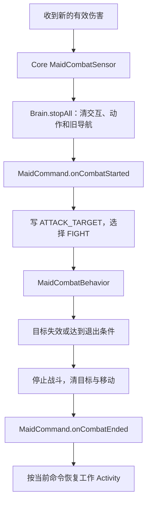

# 工作自卫与战后恢复（Minecraft 26.2 / 1.2.1）

Core 提供战斗、中断顺序与生命周期通知；Lumber、Farming、Feeding、Hauling 四个正式工作命令声明 SELF_DEFENSE。工作不需要额外的守卫按钮。

## 实际行为

| 情况 | 处理 |
| --- | --- |
| 工作期间遭到有效 PvE 目标攻击 | 停止当前交互，使用已有武器与弹药自卫 |
| 主人远处受伤、攻击怪物，或附近仅出现怪物 | 继续工作；护主和主动清怪属于跟随／战斗命令 |
| 玩家、友方或已驯服宠物造成伤害 | 不把它们选为攻击目标 |
| 目标死亡、离开范围、丢失视线或追击失败 | 清理战斗状态，恢复原工作命令 |
| 战斗中切换或重选命令 | 执行旧命令的取消、新命令的选择，不继续旧任务 |

工作遭遇战以首次遇袭位置为中心，女仆、敌人及彼此距离均限制在 12 格。换目标不移动中心。连续丢失视线 100 tick、没有追击进展 160 tick、同一目标追击 1200 tick 后退出，失败目标冷却 200 tick。主人远离工作区不阻止工作自卫。

## 数据归属和恢复

Lumber 保留本只女仆的 `LumberJob`：剩余原木、预期状态、完成和跳过计数。6000 tick 有限任务预算扣除战斗暂停时间。当前块的裂纹、动作和破坏进度立即清理，战后重新规划站位、取得真实斧头，从零积累该块进度。高处原木继续遵守实际伸手距离。已经结束的任务不会因为自卫而重启。

Farming、Feeding 和 Hauling 是循环工作。停止 Behavior 时清理短期候选、当前站位、交互计时和等待动作；战后从真实世界重新选择。完成前重新检查作物、动物资格、物品和箱子状态，因此不会重放旧快照中的操作。

Hauling 的货物仍在真实 MaidInventory 中；Attachment 仅保存槽位、种类和未交付数量。工作中断关闭打开的箱子。战后有货先交付，无货再取货。保留货物的槽位不供战斗自动换装或取箭使用。玩家手动取走货物会使旧凭据失效，不能按凭据重新生成物品。

换武器和恢复工具都转移真实 ItemStack，遵循共享装备政策。物品被玩家拿走或损坏后不会凭空恢复。工作队列、仇恨和动作进度不会跨卸载持久化；伐木重载后需要重新选择，三个循环工作则按保存的工作中心继续检查。

## 调用顺序

Vanilla 的 Activity 切换不会立即停止所有运行中的 Behavior，所以 Sensor 显式排序中断和恢复。四个工作命令使用 Core 已注册的 FIGHT，不重复贡献 Activity；工作 Activity 要求 ATTACK_TARGET 不存在。

显式选命令走 stopAll → onDeselected → 更新命令 → onSelected。临时战斗不会调用 onDeselected/onSelected，有限任务因此能区分暂停与取消。

GUI 从服务端同步命令、Activity 和具体状态。命令仍为伐木、Activity 暂时为战斗是正常的。状态不从客户端 Brain 推测。

## 验收与源码

跨模块回归验证工作中断、战后恢复、工具替换、任务预算、货物保护和显式取消。旧巡逻只作为隐藏测试夹具保留在 devrun 的 gametest 源集中，不是正式功能。最新运行结果见 [验收记录](ACCEPTANCE.md)。

- [选敌与中断](../src/main/java/io/github/ozozorz/aimaid/entity/combat/MaidCombatSensor.java)、[生命周期转发](../src/main/java/io/github/ozozorz/aimaid/entity/combat/WorkDefense.java)
- [命令契约](../src/main/java/io/github/ozozorz/aimaid/entity/maidcommand/MaidCommand.java)、[有限伐木任务](../addon/lumber/src/main/java/io/github/ozozorz/aimaid/lumber/lumber/LumberJob.java)
- [工作恢复测试](../dev/devrun/src/gametest/java/io/github/ozozorz/aimaid/integration/WorkDefenseGameTests.java)、[正式 Addon 整合测试](../dev/devrun/src/gametest/java/io/github/ozozorz/aimaid/integration/FormalAddonGameTests.java)
