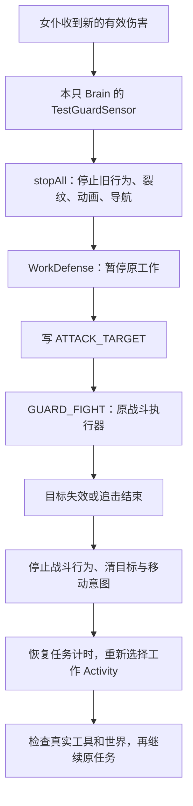

# 工作中的自卫与战后恢复（Minecraft 26.2）

本轮从 `8611f52`（动画系统）继续开发。启用 TestAddon 后，选择伐木或巡逻即可使用，无须额外按钮或切换护卫命令。

## 实际行为

| 情况 | 女仆的处理 |
| --- | --- |
| 伐木、巡逻期间受到有效 PvE 目标伤害 | 暂停工作，使用已有近战、弓、弩和武器选择机制自卫 |
| 附近出现怪物、主人攻击怪物或主人受伤 | 继续工作；护主和协助攻击仍由护卫/战斗命令负责 |
| 玩家、主人、友方或驯服宠物造成伤害 | 沿用现有 PvE 保护，不把它们选为敌人 |
| 敌人死亡、离开范围、失去视线或追击失败 | 清理战斗状态，恢复当前命令下的工作 |
| 主人远离工作区 | 仍能在工作区自卫，不受护卫模式的主人距离约束 |
| 战斗中手动选择另一个命令 | 取消旧任务，不再自动回来工作 |
| 战斗中重新选择相同工作命令 | 按原来的选择语义开启新一轮工作，放弃旧队列 |

工作自卫以首次遇袭的位置为中心，女仆、敌人及双方距离均受 12 格限制；换目标不移动这个中心。沿用 100 tick 丢失视线、160 tick 没有追击进展、最长 1200 tick 追击及失败目标 200 tick 冷却。护卫/战斗命令原来的 24 格主人范围保持原有用途。

伐木战斗期间不会拾取物品。结束后，仍按伐木命令的既有顺序继续工作或拾取。已经完成的一轮不会因为随后自卫而重新开始另一棵树。

## 恢复哪些状态

伐木保留本只女仆的同一个 `LumberJob`：剩余原木、预期方块状态、已砍数量和跳过数量。进入战斗不重新扫描一棵树，也不调用 `onSelected`。工作总预算仍为 6000 tick，但扣除自卫暂停时间。

当前一块未完成的破坏进度不保存。中断立即清裂纹、停止伐木动画；恢复时重新选可达站位，重新检查世界里的方块和真实工具，从零积累这一块的进度。已经砍下的原木不会重复掉落或扣耐久。原木被换成其他方块会跳过，旧站位被堵住会重新规划，斧头不存在则按已有“缺少工具”规则结束。高处原木继续遵守逐块触及限制。

战斗换装仍交换真实 `ItemStack`。恢复时，背包中的斧头由原工作行为保证；如果战斗曾从副手取武器，把斧头换到了副手，则先尝试交换双手。没有缓存一份工具副本，玩家在战斗中拿走工具不会凭空得到替代品。装备政策仍有此前记录的边界：工作与 GUI 等入口尚未全面统一 `PREVENT_ARMOR_CHANGE` 政策。

巡逻保留中心、半径和原巡逻点；战后重新向原巡逻点发出移动意图。停留 Memory 的计时自然流逝，若战斗期间到期，返回后可以进入下一步循环。仍保留之前用于验证装备机制的“需要斧头”条件。

这些都是当前运行实体的临时状态。卸载、跨维度或重新读档不会持久保存旧仇恨和暂停的伐木队列；重载后保留命令，旧的一次伐木请求结束，需要重新选择才能开始。巡逻的持久中心和半径沿用已有 Attachment。

## 对象与调用链



`MaidCommand` 仍是 Registry 中共享的策略对象。每只 Brain 有自己的 Sensor、Behavior 和 `LumberJob`。`workInterrupted`、追击中心与事件基线属于这只女仆的 Sensor；队列和暂停计时属于她自己的 Job。`WorkDefense` 只放静态规则，不保存女仆状态。

26.2 的 `Brain.tick` 顺序是 Memory 到期、Sensor、启动行为、推进运行中的行为。`setActiveActivityToFirstValid` 只切换活动并删除配置的 Memory，并不会立即停止所有已运行的 Behavior。因此 Sensor 在进入/退出自卫时先 `stopAll`，再处理暂停或恢复、目标 Memory 和当前 Activity。这样同一个 tick 不会继续砍树或让旧导航覆盖战斗导航。移动执行权仍由 Core 的 `MoveToTargetSink` 持有。

伐木和巡逻把已有 `GUARD_FIGHT` 放在候选列表首位，不再重复贡献该 Activity。工作 Activity 要求 `ATTACK_TARGET` 不存在；`LumberJob.isWorking` 同时检查这一条件。战斗一结束，原命令的候选重新选回工作。GUI 仍通过服务端 DataSlot 显示命令与 Activity，所以能看到“命令：伐木，活动：战斗”，然后恢复成“命令：伐木，活动：伐木”。

Core 增加了一个具体的生命周期回调 `MaidCommand.onDeselected(maid)`：服务端显式选命令时，先停止旧行为，再通知旧命令清理，然后写入新命令并调用它的 `onSelected`。重选同一对象也执行这条链。临时 Activity 切换不触发此回调，所以暂离工作 Activity 可以保留队列，而手动取消仍会立即释放队列。现有 Addon 的默认实现为空。

`TestGuardSensor` 同时比较受伤时间戳与攻击者身份。Vanilla 清空死亡攻击者也会更新时间戳，随后同一实体 tick 的新伤害可能有相同时间戳；仅比较整数会漏掉再次遇袭。模式或主人变化仍会更新基线，旧伤害记录不会在切换命令后重播。

完成的伐木任务释放 `LUMBER_JOB` 和请求，只保留 `LUMBER_DONE`。既不会长期保留一棵树的队列，也不会让完成后的一次自卫重新启动采伐。

## 验收

新增 `WorkDefenseGameTests` 的 17 项服务端集成测试，覆盖：

- 整树砍过一块后遇袭、实际近战、满包换装、同队列续砍和数量/耐久守恒。
- 副手弓的真实拉弓中断、保留弹药、把斧头换回主手。
- 手动取消、重选相同命令、战斗时间排除在工作预算之外。
- 战斗期间原木被改、工具被拿走，以及行走中的旧站位被堵。
- 主人远离、自卫范围、视线丢失、旧事件不重播。
- 巡逻中心/半径/目标保留，并实际走回原巡逻点。
- 工作不主动清怪、不护主或协助攻击。
- 连续两次中断、两只女仆状态隔离、完成后不重开任务、战中读档。

新增 `WorkDefenseClientGameTest` 在真实客户端和集成服务器中检查：已出现裂纹的作业受伤后清裂纹、切到近战并实际造成伤害；GUI 的命令保持伐木而 Activity 变战斗；战后主手斧头与背包武器镜像正确；新的伐木动画 token 和从头开始的裂纹重新出现，最终只掉一块原木、扣一次斧头耐久。原有三套客户端验收一同回归。

2026-10-16 本机最终结果：

| 检查 | 结果 |
| --- | --- |
| Core 独立 build | 通过 |
| TestAddon 独立 build 与专用服务器 GameTest | 71 / 71 通过，含新增 17 项 |
| Combat / Work / Animation / WorkDefense 客户端流程 | 四套全部通过，含 GUI 按钮实际选中状态 |
| devrun Composite Build | 通过 |
| 发布 JAR | 新类存在，15 个 JSON 资源可解析，不含 GameTest 代码 |
| 截图 | 已查看工作、自卫、恢复及菜单；共归档 25 张，含本轮新增 5 张 |

以上是自动化临时世界中的专用服务器与客户端验收，没有额外进行多人长期联机或第三方保护模组兼容测试。

复现入口（仓库根目录）：

```powershell
.\gradlew.bat build
.\gradlew.bat -p addon/testaddon build
.\gradlew.bat -p addon/testaddon runClientGameTest
.\gradlew.bat -p dev/devrun build
```

测试使用临时世界，`src/gametest` 不进入发布 JAR。本机日志与截图归档到忽略目录 `build/work-defense-acceptance/`，避开 Fabric 后续构建对临时运行目录的清理。

## 阅读入口

- [选敌与切换](../addon/testaddon/src/main/java/io/github/ozozorz/testaddon/ai/TestGuardSensor.java)
- [现有工作的暂停/恢复规则](../addon/testaddon/src/main/java/io/github/ozozorz/testaddon/combat/WorkDefense.java)
- [每只女仆的伐木队列及计时](../addon/testaddon/src/main/java/io/github/ozozorz/testaddon/lumber/LumberJob.java)
- [伐木命令](../addon/testaddon/src/main/java/io/github/ozozorz/testaddon/command/TestLumberCommand.java)、[巡逻命令](../addon/testaddon/src/main/java/io/github/ozozorz/testaddon/command/TestPatrolCommand.java)
- [Core 命令生命周期](../src/main/java/io/github/ozozorz/aimaid/entity/maidcommand/MaidCommand.java)
- [服务端测试](../addon/testaddon/src/gametest/java/io/github/ozozorz/testaddon/WorkDefenseGameTests.java)、[客户端测试](../addon/testaddon/src/gametest/java/io/github/ozozorz/testaddon/WorkDefenseClientGameTest.java)
