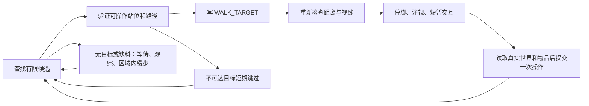

# 持续工作调度

以下机制由1.2.1引入，当前持续工作模式继续使用。1.3.0的有限动作与LLM反馈循环另见 [自主任务架构](AUTONOMOUS_TASKS.md)。

本次改动处理耕种、喂养和搬运中的重复停顿、无事可做时呆站、目标阻塞、到位后不看交互对象，以及箱子占用被误判为长时间寻路失败。保留独立 Addon、Core 通用机制和原版 Brain 导航的分工。

## 从 Touhou Little Maid 学到了什么

参考默认 1.20 分支提交 `8a3ac5e9eacf0c6d63adf8832949f3ce81484fe6`，并对照 1.21 分支提交 `207647c85740b1d0971de6040d6dd57cea62528c`。这两版使用 Forge／NeoForge，对本项目 26.2 Fabric 采用的是调度思路，不直接搬用旧版本 API。

- 工作 Activity 内可以同时有低优先级的观察和走动；不应依赖永远轮不到的 IDLE 候选。[MaidBrain](https://github.com/TartaricAcid/TouhouLittleMaid/blob/8a3ac5e9eacf0c6d63adf8832949f3ce81484fe6/src/main/java/com/github/tartaricacid/touhoulittlemaid/entity/ai/brain/MaidBrain.java)
- 选择和靠近目标与到达后的实际操作分开；成功后尽快寻找附近下一目标，失败扫描降低频率。[MaidMoveToBlockTask](https://github.com/TartaricAcid/TouhouLittleMaid/blob/8a3ac5e9eacf0c6d63adf8832949f3ce81484fe6/src/main/java/com/github/tartaricacid/touhoulittlemaid/entity/ai/brain/task/MaidMoveToBlockTask.java)、[MaidCheckRateTask](https://github.com/TartaricAcid/TouhouLittleMaid/blob/8a3ac5e9eacf0c6d63adf8832949f3ce81484fe6/src/main/java/com/github/tartaricacid/touhoulittlemaid/entity/ai/brain/task/MaidCheckRateTask.java)
- 喂养先过滤可见、具备饲料和能够接近的动物，避免最近的无效目标堵住后面的工作。[MaidFeedAnimalTask](https://github.com/TartaricAcid/TouhouLittleMaid/blob/8a3ac5e9eacf0c6d63adf8832949f3ce81484fe6/src/main/java/com/github/tartaricacid/touhoulittlemaid/entity/ai/brain/task/MaidFeedAnimalTask.java)

本项目没有引入 TLM 的寻路器、攀爬、自动屠宰或无线箱子交换。搬运继续采用用户选定的铜傀儡规则，伐木继续严格走到可触及的位置。

## 本项目的运行阶段

业务仍是每只 Brain 独立的 Behavior。阶段由当前目标、站位、交互计时和等待标记表达，没有新增共享的通用 WORK_TARGET，也没有建立万能职业系统。工作阶段优先，`MaidWorkIdle` 仅在 Addon 明确允许等待时运行。

## 解决的具体问题

| 原问题 | 当前处理 |
| --- | --- |
| WORK 一直有效，无任务时无法轮到 IDLE | 同一工作 Activity 添加低优先级观察与短距离移动 |
| 每做一次都固定等 20 tick，再全范围重扫 | 耕种保留候选、靠近最近完成点继续；喂养完成后立即考虑下一只 |
| 走得到站位却够不到目标 | 规划站位同时检查实际交互距离、视线、碰撞和加载状态 |
| 到位 stop 顺手清掉 LOOK_TARGET | 停止移动与停止整个工作分开；交互期间持续注视 |
| 缓慢移动到 200 tick 就被放弃 | 移动阶段检查实际位移，80 tick 无进展才短期跳过 |
| 最近动物被挡住，其他动物一直等 | 可见性、饲料和可达站位在选中前检查；移动目标重新规划 |
| 箱子被别人打开超过 400 tick 后被冷却 6000 tick | 占用不计入路径失败；尝试其他箱子，仅忙碌时 20 tick 重试 |
| 空闲动作退出时清掉刚写入的新工作目标 | 按 Memory 对象身份清理，只撤回自己仍然持有的意图 |

26.2 的 MoveToTargetSink 到达判定基于“进入目标方格”，不是精确走到中心。站位规划因此保留半格对角线的距离余量，且不重复选择当前已站在其中却无法操作的格子。目标或速度变更时停止旧路径，让 sink 重新接管；实际导航执行权仍归原版。

## 各工作节奏

**耕种：** 扫描已加载工作区域，候选按最近完成位置排序，每次最多 16 个参与一次多目标寻路。到位准备 6 tick，再执行原有的一次掉落计算、扣种子、容量检查、世界修改与背包提交。下一目标在下一个 tick 继续。无工作时扫描间隔从 40 增至 80、160 tick，并加 0–9 tick 抖动；满包或缺种子时等待 80 tick。背包版本变化可提前唤醒。

**喂养：** 原版年龄、繁殖冷却、饲料、动物标签和主人规则保持不变。可见但没有可达站位的目标暂时跳过；每轮最多为 16 只动物规划路径。目标移动后按需重新选站位，到位准备 6 tick；喂之前重新检查资格、真实饲料和伸手范围。一次只消耗一份，随后考虑下一只。缺料或无合格动物逐渐降低扫描频率，补料可以提前唤醒。

**搬运：** 只缓存已加载箱子的坐标，查找时重新解析真实容器及内容；需要查找时，坐标扫描最短间隔 80 tick。铜箱取货、空箱／同类箱交付、每批 16 件和 60 tick 交互保持不变。忙碌箱子每 20 tick 重试，无来源／目的地等 140 tick，真实寻路失败冷却 100 tick。箱子忙碌和实际交互不累计为导航卡死。

**工作空闲：** 没有实际任务时先观察，持续等待后间隔性走动最多约两格。脚部路径保持同一高度，整条空闲路径位于工作区域内。禁用世界破坏、被拴住、乘坐、工作维度不符或进入战斗时不启动这些等待动作。忙碌交互阶段不闲逛。

## 机制与边界

Core 新增或完善的机制是 `MaidWorkNavigation`、`MaidWorkIdle` 和 `MaidInventory.getChangeVersion`；业务目标、失败原因和冷却时长属于各 Addon。详见 [公共 API](ADDON_API.md)。

候选缓存和失败记录都是当前 Behavior 的临时状态，停止、切命令或战斗中断时清理；战后重新读取世界。货物仍使用原有持久凭据，Lumber 的有限树队列仍遵循自己的暂停恢复规则。

移动进度检测能避免简单卡死和过短的总时限，不保证解决所有复杂地形或绕圈路径。工作目标受区域约束，但实际工作路径可能为了绕障短暂离开区域；空闲走动则额外约束整条路径。扫描不强制加载区块。保护模组、特殊机器和第三方动物仍需实际适配。

## 验收入口

新增真实服务端场景验证连续农田、操作前注视、补料唤醒、空闲范围、新工作接管、慢速持续接近、隐藏／封闭围栏动物、移动动物、动态遮挡、忙碌箱子恢复及替代箱子。完整结果和客户端截图见 [验收记录](ACCEPTANCE.md)。
